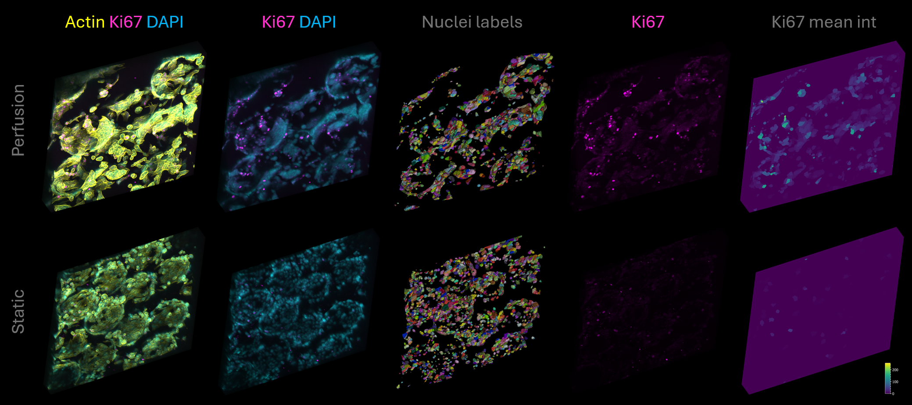

# margrecs_alginate: 3D cell population analysis of alginate-bead cultures

[](https://doi.org/10.5281/zenodo.24281254)
[](https://github.com/adiezsanchez/margrecs_alginate/blob/main/LICENSE)

3D multichannel image analysis of alginate-bead cell cultures acquired as Leica `.lif` containers. The pipeline corrects for Z anisotropy from Leica metadata, segments nuclei or dual fluorescent populations in 3D, extracts morphological and channel-wise intensity features with scikit-image, and aggregates per-image CSVs for downstream comparison of experimental conditions.



Two analysis tracks are supported:

- **Ki67 proliferation**: DAPI / F-Actin / Ki67 stacks; GPU Voronoi–Otsu nuclear segmentation (pyclesperanto); continuous nuclear Ki67 intensity summarized by static vs perfusion and culture day.
- **A549/HPFa co-culture**: dual fluorescent populations segmented independently with CellposeSAM; green→red bleedthrough masking and filtering; per-image cell counts compared across FGF condition, culture day, and hours prior to HPFa addition.

> [!WARNING]
> - A **CUDA-capable GPU** is required for CellposeSAM (co-culture track). Voronoi–Otsu (Ki67 track) uses OpenCL via pyclesperanto.
> - In notebooks that call pyclesperanto, `cle.select_device(...)` must match your OpenCL device name (edit if needed).

> [!NOTE]
> - Input images are read as **Leica `.lif`**. Stacks are returned in channel-first order after loading: `(channel, Z, Y, X)`.
> - Voxel spacing is read from Leica XML metadata and used to compute a Z rescale factor for anisotropy correction before segmentation.

---

## Notebooks

Notebooks are numbered by typical run order within each track (`0_` single-image QC → `1_` batch → `2_` data analysis).

### Ki67 proliferation

| Notebook | Description |
|----------|-------------|
| **`0_SP_Ki67_single_lif_image.ipynb`** | Single-image QC: load one `.lif` stack, segment nuclei (CellposeSAM or Voronoi–Otsu), extract morphology and marker intensities, optional Napari visualization. |
| **`1_BP_Ki67_multiple_lif_containers.ipynb`** | Batch over `.lif` containers; writes one per-object CSV per image under `results/<lif_container_id>/`. |
| **`2_Ki67_data_analysis.ipynb`** | Merges batch CSVs, parses condition/day/magnification from identifiers, filters by volume and Ki67 intensity percentiles, and plots Ki67 mean intensity across static vs perfusion and culture days. |

### A549/HPFa co-culture

| Notebook | Description |
|----------|-------------|
| **`0_SP_COC_single_lif_image.ipynb`** | Single-image co-culture QC: dual-channel CellposeSAM (or Voronoi–Otsu) segmentation, HPFa bleedthrough masking/`%_area_cleaned` filtering, feature extraction, Napari visualization. |
| **`1_BP_COC_multiple_lif_containers.ipynb`** | Batch co-culture processing; skips filenames containing `5x`; writes one CSV per image under `coc_results/<lif_container_id>/` (configurable). |
| **`2_COC_data_analysis copy.ipynb`** | Merges co-culture CSVs, parses FGF condition/day/hours prior to HPFa, filters by volume, and summarizes per-image cell counts by population and experimental factors. |

---

## Analysis pipeline (per image)

1. **Read** one image from a `.lif` container as `(C, Z, Y, X)`; extract voxel spacing from Leica metadata.
2. **Anisotropy correction**: compute Z rescale factor (`z_um / mean(x_um, y_um)`) for isotropic segmentation.
3. **Segmentation**
   - *Ki67:* nuclei on the DAPI channel (default Voronoi–Otsu; CellposeSAM optional).
   - *Co-culture:* independent 3D labels for `A549_green` and `HPFa_red` (default CellposeSAM); mask HPFa voxels overlapping A549; drop HPFa objects with `%_area_cleaned` ≥ threshold (default 20%).
4. **Features**: scikit-image `regionprops_table` morphology plus per-marker intensity statistics; metadata columns (`lif_container_id`, `lif_image_name`, and for COC `population`).
5. **Export**: one CSV per image; label TIFFs cached under the raw-data tree (`nuclei_labels/` or `cell_labels/`) for reuse.

Core logic lives under `src/utils/`.

---

## Utility modules

| Module | Role |
|--------|------|
| **`utils/io.py`** | List/load `.lif` containers, Leica voxel spacing and Z rescale factor, label TIFF I/O helpers. |
| **`utils/segmentation.py`** | CellposeSAM and Voronoi–Otsu 3D labeling; volume filtering; HPFa/A549 colocalization cleaning. |
| **`utils/feature_extraction.py`** | Per-object morphology and channel-wise intensity tables (`regionprops_table`). |
| **`utils/batch_processing.py`** | Configurable Ki67 and COC batch runners with logging, skip/overwrite, and CSV export. |
| **`utils/data_processing.py`** | Parse experimental metadata from file/container identifiers (condition, day, magnification, hours prior to HPFa); optional Ki67 k-means status helper. |
| **`utils/data_viz.py`** | Map per-label features onto label images in Napari; 3D centroid scatter plots. |

---

## Output layout

```text
results/<lif_container_id>/          # Ki67 batch (default)
  <image_name>.csv                   # one row per segmented nucleus

coc_results/<lif_container_id>/      # co-culture batch (default)
  <image_name>.csv                   # A549_green + filtered HPFa_red rows

<raw_data>/<nuclei_labels|cell_labels>/<lif_container_id>/
  <image_id>_*.tif                   # cached label images

processed_results/                   # from analysis notebooks
  merged / filtered tables and figures
```

---

## Running Jupyter with Pixi

[Pixi](https://pixi.sh/) manages the environment (Python, PyTorch/CUDA, Cellpose, Jupyter, Napari, pyclesperanto, etc.). Platforms: `win-64`, `linux-64`, `osx-arm64`.

1. **Install Pixi** (if needed): https://pixi.sh/latest/install/

2. **From the project root**, install the environment and start Jupyter Lab:

   ```bash
   pixi install
   pixi run lab
   ```

   This starts Jupyter Lab with the project kernel. Open any `.ipynb` notebook and run the cells.

To launch the Napari viewer only: `pixi run napari`.

> [!TIP]
> Set the raw-data path and marker/channel indices at the top of each notebook (or in the batch config dict) before running.

---

## Materials and Methods: Image analysis

Three-dimensional multichannel confocal stacks of alginate-bead cultures were acquired as Leica .lif containers and processed with a custom Python pipeline. Images were loaded as (channel, Z, Y, X) arrays, and voxel spacing from Leica metadata was used to correct for anisotropy prior to segmentation. For each segmented object, morphological descriptors and channel-wise intensity statistics were extracted using scikit-image region properties. Image-level feature tables were generated in batch across containers and merged for downstream analysis using pandas. All analysis code is openly available at GitHub and deposited in Zenodo.

Ki67 proliferation. Cultures stained for DAPI, F-Actin, and Ki67 were segmented on the DAPI channel using GPU-accelerated Voronoi–Otsu labeling (pyclesperanto; spot and outline σ = 2). Morphological and intensity features were computed for DAPI, F-Actin, and Ki67. Experimental condition (static vs perfusion), culture day (3, 7, or 14), and magnification were parsed from file identifiers. Analyses were restricted to 10× images; nuclei outside a volume range of 500–6500 voxels and Ki67 mean intensities outside the 1st–99th percentiles were excluded. Continuous nuclear Ki67 mean intensity was then summarized and compared between conditions across culture days.

A549/HPFa co-culture. Dual fluorescent populations (A549_green and HPFa_red) were segmented independently in 3D with pre-trained CellposeSAM (v4.0.6). To mitigate green fluorescence bleedthrough into the red channel, HPFa_red signal overlapping A549_green predictions was masked while preserving label IDs, and HPFa_red segmented objects with ≥20% area masked (%_area_cleaned) were excluded. Images whose filenames indicated 5× magnification were skipped. Morphological and intensity features were retained for A549_green and filtered HPFa_red populations. FGF condition (+FGF vs −FGF), culture day (1 or 3), and hours of A549 culture prior to HPFa addition (24 or 48 h) were parsed from file identifiers. Cells outside a volume range of 500–6500 voxels were excluded. Per-image cell counts for each population were then summarized and compared across FGF condition, culture day, and hours prior to HPFa.

---

## How to cite this pipeline

If you use this pipeline to analyze your bioimage data, you can include it in your references as follows:

- For APA and BibTeX, scroll to the top of this repository page, above the Release section, and under **About** click **Cite this repository**.
- For APA, Harvard, MLA, Vancouver, Chicago, and IEEE styles, visit the Zenodo record (see DOI badge below) and use the **Citation** section in the right panel.
- For licensing terms, see `LICENSE` (BSD 3-Clause).

[](https://doi.org/10.5281/zenodo.24281254)

Example APA citation:

```
Díez-Sánchez, A. (2026). margrecs_alginate: 3D cell population analysis of alginate-bead cultures (Version v1.0.0) [Computer software]. Zenodo. https://doi.org/10.5281/zenodo.24281255
```

---

## Related publications

Placeholder for publications citing this pipeline.
